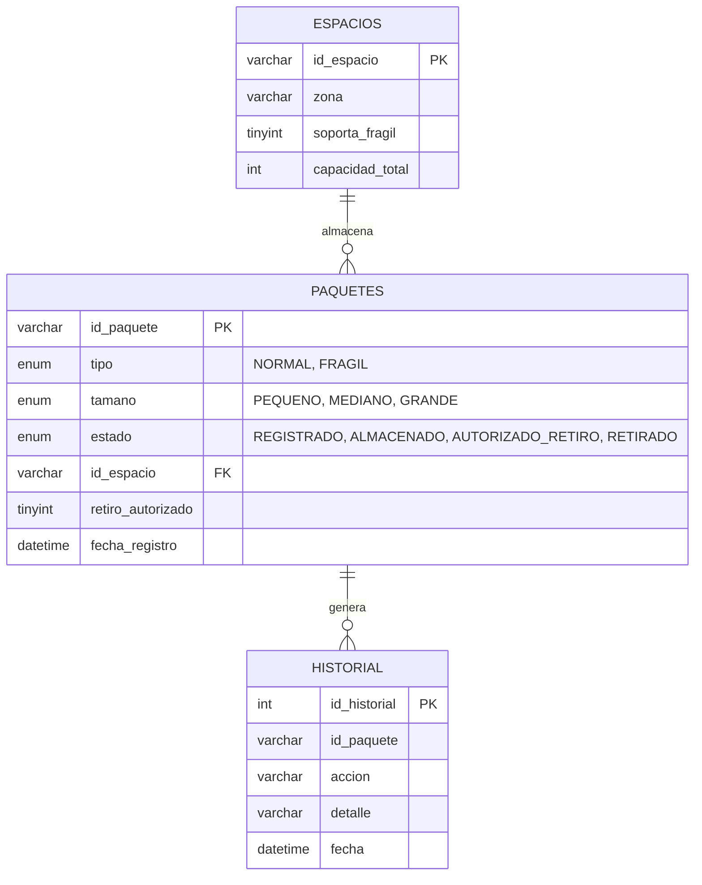

# Diagrama Entidad-Relación (DER)

Base de datos **bodega_db** (MySQL). El script que la crea es `db/bodega_db.sql`.

## Diagrama

GitHub muestra este diagrama automáticamente; en otros visores se puede pegar el bloque en <https://mermaid.live>.

## Entidades

| Tabla | Descripción | Llave primaria | Llaves foráneas |
|---|---|---|---|
| `espacios` | Cada cuadro físico del mapa de la bodega | `id_espacio` | — |
| `paquetes` | Paquetes registrados y su estado actual | `id_paquete` | `id_espacio` → `espacios` (puede ser nulo mientras no esté almacenado) |
| `historial` | Bitácora de comandos ejecutados y alarmas | `id_historial` (autoincremental) | `id_paquete` se guarda como referencia informativa (sin restricción, para conservar la bitácora aunque el paquete cambie) |

## Relaciones

- **Un espacio almacena muchos paquetes** (1:N). Un paquete está en como máximo un espacio.
- **Un paquete genera muchos registros de historial** (1:N).

## Reglas de negocio que apoya el modelo

**Capacidad por espacio.** Cada espacio tiene `capacidad_total = 6` unidades y cada tamaño ocupa un número fijo de ellas, de modo que se cumple 1 Grande / 2 Medianos / 3 Pequeños:

| Tamaño | Unidades | Cabe por espacio |
|---|---|---|
| GRANDE | 6 | 1 |
| MEDIANO | 3 | 2 |
| PEQUENO | 2 | 3 |

**Frágiles.** Un paquete de `tipo = 'FRAGIL'` solo puede ir a un espacio con `soporta_fragil = 1` (zona A en los datos iniciales).

**Retiro autorizado.** `RETIRAR` solo es válido si `retiro_autorizado = 1` (fijado por `AUTORIZAR_RETIRO`); de lo contrario se registra una alarma en `historial`.

**Colores del mapa.** La vista `vista_estado_espacios` calcula las unidades ocupadas (solo paquetes en estado `ALMACENADO`) y devuelve el estado que usa la interfaz:

| Estado | Condición | Color |
|---|---|---|
| LIBRE | 0 unidades ocupadas | Verde |
| PARCIAL | Entre 1 y 5 unidades | Amarillo |
| LLENO | 6 unidades (capacidad completa) | Rojo |

## Datos iniciales

Seis espacios con capacidad 6: `E01` y `E02` en la zona A (aptos para frágiles), `E03` y `E04` en la zona B, `E05` y `E06` en la zona C.

## Nota sobre el nombre de la base de datos

El PDF del proyecto menciona `bodega_bd` en la Fase 1 y `bodega_db` en el reparto de Manuel. Se usó **`bodega_db`**, que coincide con el archivo `bodega_db.sql` y con la cadena de conexión de `ConexionBD.cs`.
